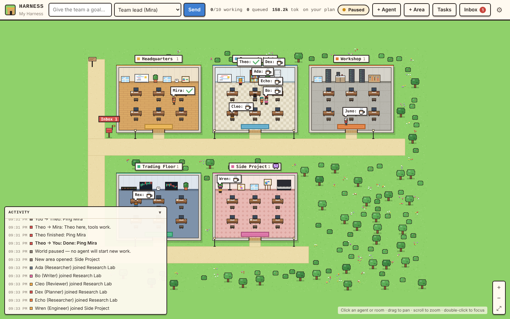

# Harness

A playground where a team of AI agents researches, builds, and talks things through across all your projects, and you watch it happen in a little pixel-art town.



- **Areas** are rooms. Each one is a project or line of work (a research stream, a trading desk, a repo). Point an area at a folder and its agents can read and edit that code.
- **Agents** live in areas. Click one to see what it's thinking and writing right now, give it a task, message it, or read its history. Hire new agents from templates (researcher, engineer, markets analyst, writer, reviewer, planner, chief of staff) or write your own role.
- **They work together.** Agents message each other, delegate pieces of work, and wake up when a teammate's result comes back. Envelopes fly across the map when they do.
- **They report back to you.** Finished work, recommendations, and questions land in your **inbox** (the red mailbox) with action items you can tick off, reply to, or send back for another pass.
- **Everything persists.** Areas, agents, memories, notes, tasks, and the inbox survive restarts.

## Quick start

```bash
npm install
```

```bash
npm run build
```

```bash
npm start
```

Then open **http://localhost:3456**. You start with a small team: Mira (Chief of Staff, Headquarters), Theo (Researcher), Juno (Engineer), and Rex (Markets Analyst). Type a goal into the bar at the top. It goes to Mira, who plans the work, hands it out, and reports back.

## Do I need an API key?

No. There are two ways for agents to think, and the harness picks one automatically:

| Engine | What you need | How it's paid for |
|---|---|---|
| **Claude Code** (default when no API key is set) | [Claude Code](https://claude.com/claude-code) installed and logged in with your Claude account (Pro or Max) | Your Claude plan's usage limits; no per-token bill |
| **Anthropic API** | `ANTHROPIC_API_KEY` in `.env` | Per token, at API prices |

With the Claude Code engine, each time an agent works it runs `claude -p` headlessly in its area's folder, so it gets Claude Code's own file, search, shell, and web tools. Team tools (messaging, delegating, reporting to you) are served to it through a private MCP endpoint on the playground. Things to know:

- Agents share your plan's usage limits with your own Claude use. A busy team can use them up quickly; keep **Agents working at once** low (Settings) on Pro. If a limit is hit, the harness pauses itself and puts the work back in the queue; press **Resume** once the limit resets.
- The model is whatever your Claude Code uses by default unless you pick one per agent.
- Task runs are saved as Claude Code sessions so a long task can pick up where it left off (see below). They'll show up in `claude --resume` for that folder; quick message-only runs aren't saved.

Switch engines any time in **Settings → How agents run**, or with `HARNESS_ENGINE=claude-code|api|auto`.

## Using it

**Give the team a goal.** The bar at the top sends a task to the team lead, or pick any agent or area from the dropdown. Tasks can repeat (every 30 minutes, hourly, daily), which is handy for things like a morning market scan.

**Click around the map.**
- An **agent** opens its panel: live thinking and output, its queue, and tabs for activity, tasks, messages, memory, and profile. Give it a task, message it, pause it, edit its role or model, or move it to another area.
- A **room** opens the area: its purpose and folder, team, task board, and notes board. Notes are standing context every agent there reads before it starts work ("use pnpm", "focus on small caps").
- The **mailbox** opens your inbox. Reply to an agent, tick off action items, or use **Send as task feedback** to get a revised version of a result.

**Add areas and agents.** **+ Area** opens a new room. Give it a purpose, a look, and optionally a folder (any repo on your machine). Turn on **commands** only for folders where you're happy for agents to run tests and builds. **+ Agent** hires someone from a template. Lead agents (Chief of Staff) can also hire specialists and open areas themselves when a goal needs it.

**Work across repos.** Make one area per repo or project. Each area's agents work in its own folder, and they ask teammates in other areas for anything outside it. For example, a Research Lab finds an approach, a Workshop attached to `~/code/bot` implements it, and a Trading Floor analyst checks the numbers.

Keyboard: `/` focus the goal bar · `i` inbox · `t` tasks · `f` fit map · `+`/`-` zoom · `Esc` close.

## Use it from Claude Code (MCP)

The harness is also an MCP server, so you can drive it from a Claude Code session ("have the research lab look into X", "what's in my inbox?").

```bash
claude mcp add harness -- node /absolute/path/to/harness/dist/index.js mcp
```

If a playground is already running (`npm start`), the MCP server forwards to it, so Claude Code and the web UI share one live world. Otherwise it starts one, UI included.

For Claude Desktop, add to `claude_desktop_config.json`:

```json
{
  "mcpServers": {
    "harness": {
      "command": "node",
      "args": ["/absolute/path/to/harness/dist/index.js", "mcp"]
    }
  }
}
```

| Tool | What it does |
|---|---|
| `harness_overview` | Areas, agents and what they're doing, open tasks, engine status |
| `assign_task` | Give work to an agent, an area, or (by default) the team lead; optional repeat |
| `send_message` | Message an agent, an area, or everyone |
| `get_inbox` | Reports, questions, and results the agents brought back |
| `iterate_task` | Send a finished task back with feedback for another version |
| `list_tasks` / `get_task` / `cancel_task` | Track and manage work |
| `create_area` / `update_area` / `delete_area` | Manage areas, including attaching a repo folder |
| `create_agent` / `update_agent` / `remove_agent` / `pause_agent` / `get_agent` | Manage the team |
| `post_note` | Pin standing context on an area's board |
| `list_templates` | Agent templates and area themes |
| `set_paused` / `update_settings` | Pause or stop everything, change engine and limits |

## How the agents work

Each agent is persistent: a name, a role (its system prompt), an area, a memory, and a queue. It wakes up when it has a queued task or new messages, works through a tool-use loop, and goes idle again. Every activation starts with a briefing: its area's purpose and folder, who's on the team and what they're doing, the area's notes board, its own memory, its recent work, and whatever woke it.

Team tools every agent has:

| Tool | Purpose |
|---|---|
| `send_message` | Talk to a teammate, an area, everyone, or you |
| `delegate_task` | Hand work to a teammate or area; the result comes back as a message, and the agent picks up where it left off |
| `complete_task` | Hand over the deliverable for the current task |
| `report_to_user` | Put a report with action items in your inbox |
| `post_note` / `remember` | Share context with the area / keep a personal memory |
| `team_status` | See who's doing what and how delegated work is going |
| `hire_agent` / `open_area` | Leads only: grow the team |

Plus, depending on the area and agent: file tools scoped to the area's folder (read, search, write, edit), shell commands if the area allows them, and web search and fetch.

### Keeping it under control

A team that talks to itself can run up a bill or chew through a plan, so there are several brakes (all adjustable in Settings):

- **Agents working at once** (default 3). Everything else waits in the queue.
- **Conversation depth** (default 3). Agent-to-agent replies past this depth are delivered but don't wake the recipient. Delegated results always come back.
- **Delegation depth** (default 3). How many hand-offs deep a task can go.
- **Activations per agent per hour** (default 40). A circuit breaker for loops.
- **Steps per run** (default 50) and **fresh runs per task** (default 5). When an agent uses up its steps partway through a task, it doesn't stop: the harness saves its progress and starts a fresh run that picks up where it left off. With Claude Code it reopens the same session, so the agent keeps everything it had read; with the API it continues the same conversation, or reads a progress summary after a restart. If a task still isn't done after its fresh runs, it comes back to your inbox with the progress so far, and **Iterate** sends it back to keep going.
- **Pause** stops new work; **Stop all agents now** also interrupts running ones and puts their tasks back in the queue.

File tools can't leave an area's folder (`..` paths, absolute paths, and symlinks pointing outside it are all refused). Shell commands are off unless you turn them on per area. The playground only listens on `127.0.0.1` and rejects requests from other origins.

## Configuration

| Variable | Default | |
|---|---|---|
| `HARNESS_ENGINE` | `auto` | `claude-code`, `api`, or `auto` (API if a key is set, else Claude Code) |
| `ANTHROPIC_API_KEY` | — | Needed only for the API engine |
| `HARNESS_MODEL` | `claude-opus-5-5` | Default model for the API engine |
| `CLAUDE_BIN` | `claude` | Path to the Claude Code executable |
| `HARNESS_PORT` | `3456` | Web UI port (`DASHBOARD_PORT` also works) |
| `HARNESS_HOME` | `~/.agent-harness` | Where the world is saved (`world.json`) |
| `HARNESS_HOST` | `127.0.0.1` | Interface to bind. Only change this if you understand that anyone who can reach it can direct your agents |

Put these in a `.env` file in the project folder, or pass `--port`, `--home`, `--host` on the command line. To start fresh, delete `world.json` from the home folder (or point `--home` somewhere new).

## Development

```bash
npm run dev
```

Runs the playground with `tsx`. The frontend in `src/server/public` is plain ES modules with no build step; reload the page after editing. `npm run typecheck` checks the backend.

```
src/
  index.ts               CLI: `serve` (playground) and `mcp` (MCP server, proxying to a running playground if any)
  config.ts              Env/flags, model prices
  world/
    types.ts             Areas, agents, tasks, messages, inbox, notes, events
    world.ts             The world store: mutations, event stream, JSON persistence
    scheduler.ts         Who works next: queues, concurrency, chatter limits, recurring tasks
    blueprints.ts        Agent templates, area themes, starter team, sprite looks
  agents/
    runtime.ts           One activation: briefing → engine loop → deliver results
    claude-code.ts       Engine: headless Claude Code on your Claude plan
    bridge.ts            MCP endpoint that gives Claude Code agents their team tools
    engine.ts            Engine detection and choice
    tools.ts             Team, workspace, and web tools
    workspace.ts         Folder-scoped file and shell access
    prompts.ts           System prompt and per-activation briefing
  api/
    methods.ts           Every operation, shared by the web UI and MCP
    mcp.ts               MCP server (local or proxy)
  server/
    http.ts              Static UI, /api/rpc/<method>, /api/state, /events (SSE), agent bridge
    public/              The town: pixel.js (art), town.js (map, sprites), app.js (panels)
```

## License

MIT

## External agents over email (e.g. Instinct)

Some agents live outside the harness and are reached by email. Once you connect an email account, the round trip is fully automatic: tasks and direct messages for that agent are emailed, its replies are read from your mailbox, and they come back as task results (or as messages to whichever teammate wrote to it).

1. **Add the agent.** Click **+ Agent**, name it (e.g. **Instinct**), pick an area, and enter its address under **External email agent**. The address is stored only in your local `world.json`.
2. **Connect the account to send from, once.** Open **Settings → Email → Connect email** (the banner and task cards link there too). For Gmail, turn on 2-step verification, create an app password at myaccount.google.com/apppasswords, and make sure IMAP is on in Gmail settings. The harness signs in to check that sending and reading both work, then saves the account to `~/.agent-harness/mail.json` (readable only by you, never in the repo). Other providers work too via the custom server fields; school and work Microsoft accounts usually block app passwords. Environment variables still work and take priority: `HARNESS_MAIL_USER`, `HARNESS_MAIL_APP_PASSWORD`, optionally `HARNESS_MAIL_FROM_NAME`, `HARNESS_MAIL_SMTP_HOST`/`_PORT`, `HARNESS_MAIL_IMAP_HOST`/`_PORT`.
3. **That's it.** Anything that was waiting goes out as soon as the account is connected. Each email carries a `[Harness <task id> v<n>]` tag in the subject. Every 30 seconds the harness checks your mailbox (Gmail's All Mail, so replies a filter archived still count). A reply is accepted only if it comes from the agent's address, keeps that task's tag, arrived after the task email, and passes sender authentication (DMARC, or DKIM for the agent's domain; `HARNESS_MAIL_REQUIRE_AUTH=0` turns that check off). The quoted history is stripped and the rest becomes the result. Reply text is stored as data and never run as an instruction.

What happens when things go wrong:

- **A send fails for a temporary reason** (network, server busy): it retries on its own after 1, 5, 15, 60, 180 and 360 minutes, then tells you.
- **The login is rejected**: you get an inbox note, and everything waiting goes out as soon as you reconnect the account.
- **The harness stops mid-send**: on the next start it looks for the email in your Sent folder before deciding to send, so nothing goes out twice. **Send now** on a task does the same check.
- **Daily limit**: at most 40 emails per 24 hours by default (Settings), as a brake on runaway loops. Over the limit, emails wait until there's room.
- **No reply after 3 days**: you get an inbox note; the task keeps waiting.
- **Messages**: a direct message to the agent is emailed, and its reply goes back to the sender as a message, so the usual conversation-depth limit still applies. Broadcasts to an area or "everyone" aren't emailed.

The harness must be running to send and to pick up replies; anything that arrived while it was off is picked up on the next check. You can always **Send it yourself instead** or **Record a result by hand** from the task card. Email is a task proposal, not proof of anyone's permission: confirm sensitive work, spending, or private-data access with Instinct directly. Cancelling a task stops local tracking, not an email already sent. Repeating tasks send a new email each iteration.

From MCP: `create_agent` with `email`, `email_status`, `retry_email`, and `get_task` (shows the handoff and send status). Connecting the account is UI-only so the password never passes through a chat transcript.

Run `npm test` for the email lifecycle tests, plus `npm run typecheck` and `npm run build`.
